<div align="center">

# Margin Notes

### AI Study Assistant using Retrieval-Augmented Generation

Ask questions about your PDF chapters and get answers grounded in your own notes, with the file and page each answer came from.


[Report (PDF)](docs/Margin_Notes_Report.pdf) · [Slides (PDF)](docs/Margin_Notes_Presentation.pdf) · [Setup guide](docs/SETUP.md)

</div>

<p align="center">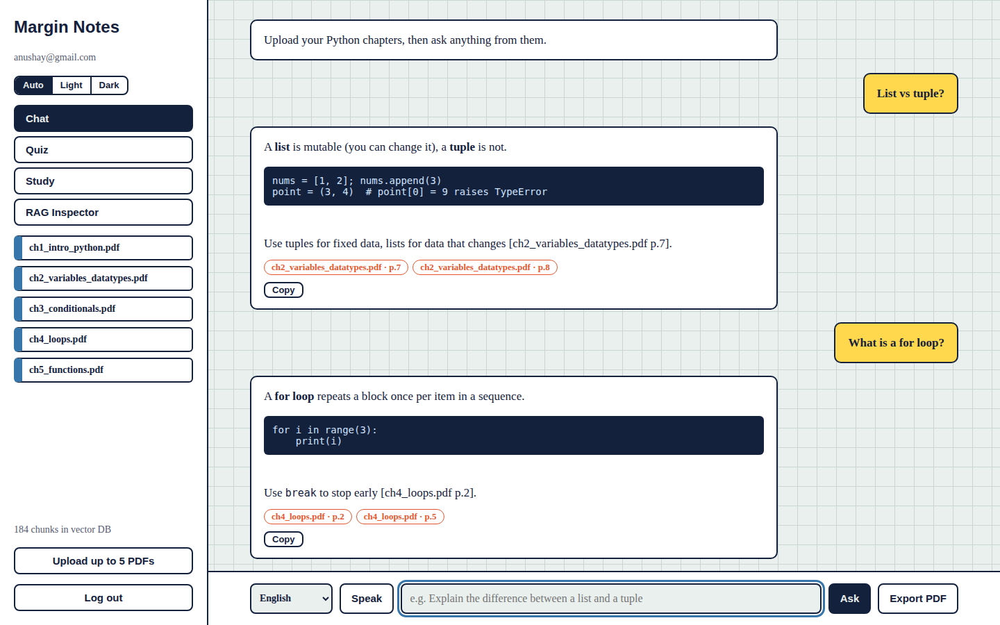</p>

## Overview
Margin Notes is a study assistant built for the SMIT assignment *AI Study Assistant using RAG (Embeddings + Grok)*. You upload up to five Python PDF chapters; the app splits them into chunks, creates embeddings, stores them in ChromaDB, retrieves the most relevant chunks for each question, and asks the LLM (Groq `openai/gpt-oss-20b`; Grok from xAI is also supported) to answer **only from those chunks**. If the notes do not contain the answer, it says so instead of guessing.

## Features
| | |
|---|---|
| **Grounded answers** | Streaming answers with source chips (file and page) and a copy button |
| **Chat memory** | Follow-ups such as "give an example" retrieve the right chunks |
| **Honest by design** | Similarity guard: below `MIN_SCORE` the app refuses to guess |
| **RAG Inspector** | Chunks per PDF, embedding size, sample embeddings, similarity scores of the last question |
| **Evaluation** | 10 test questions, reported as top-1, top-5 and MRR |
| **Study tools** | Quiz mode with scoring, chapter summaries, flashcards |
| **Languages and input** | English, Roman Urdu, Urdu answers; voice input (Chrome/Edge) |
| **Accounts** | Email/password and Google login (Firebase Auth); chat history saved in Firestore |
| **Themes** | Light, dark or automatic (follows your system); the choice is remembered |
| **Export** | Save a conversation as PDF from the browser print dialog |

## Screenshots
*UI screenshots use demo data; real runs show your own PDFs and live LLM answers.*

| Login | Quiz |
|---|---|
| 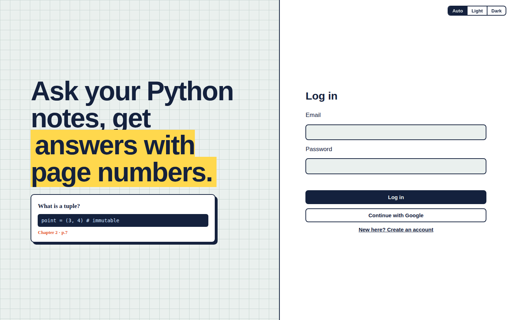 | 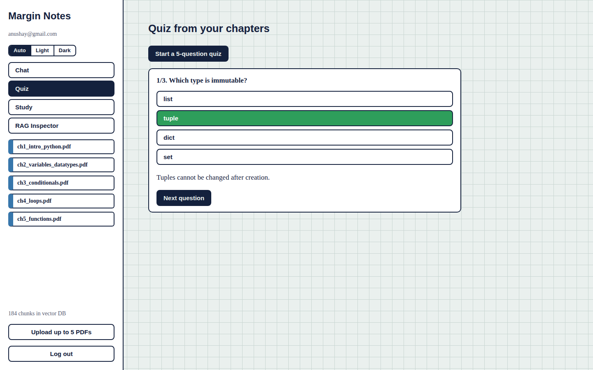 |
| **Flashcards** | **RAG Inspector** |
| 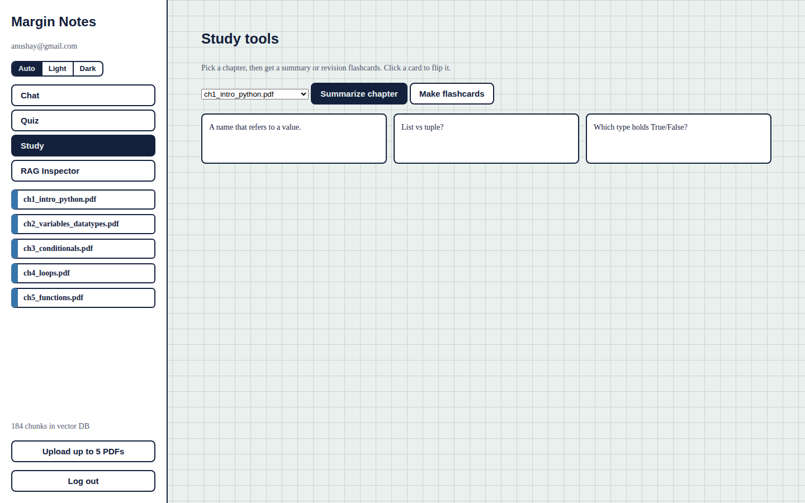 | 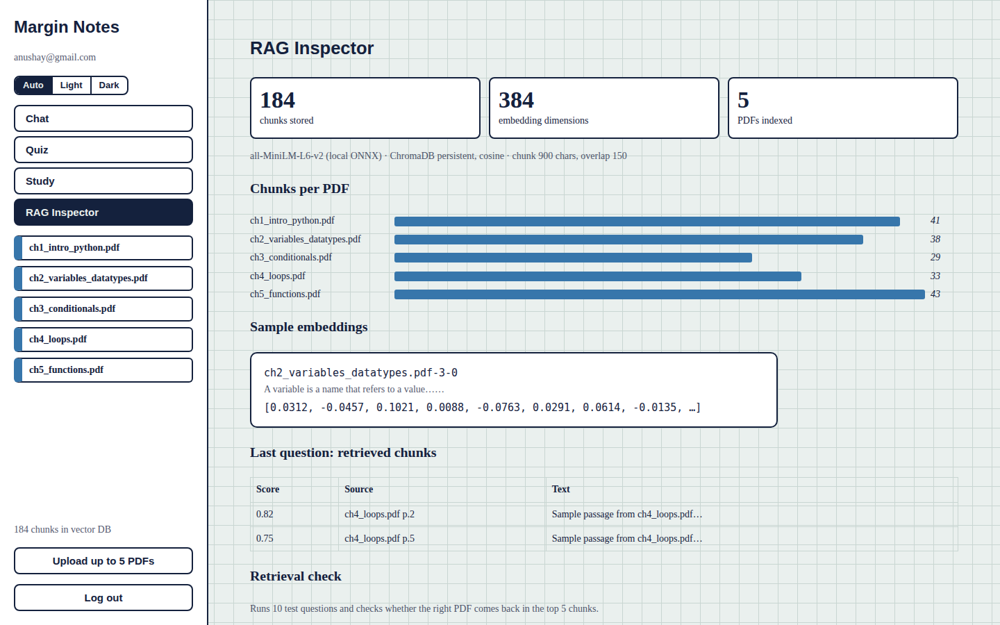 |
| **Retrieval evaluation** | **Mobile** |
| 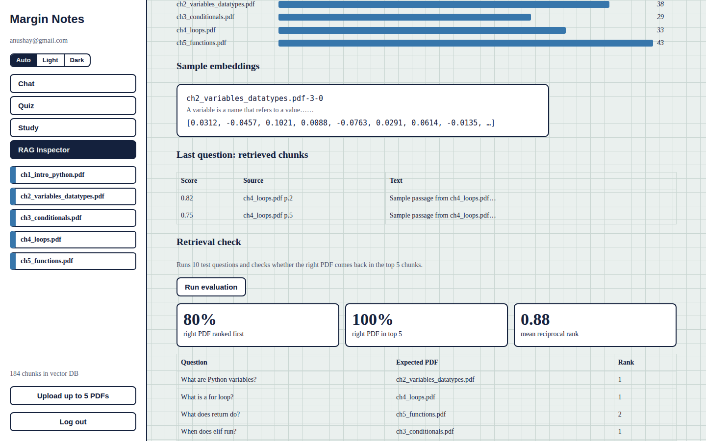 | 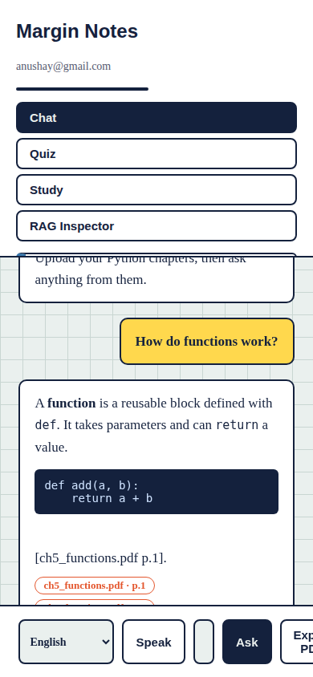 |
| **Dark mode** | **Dark login** |
| 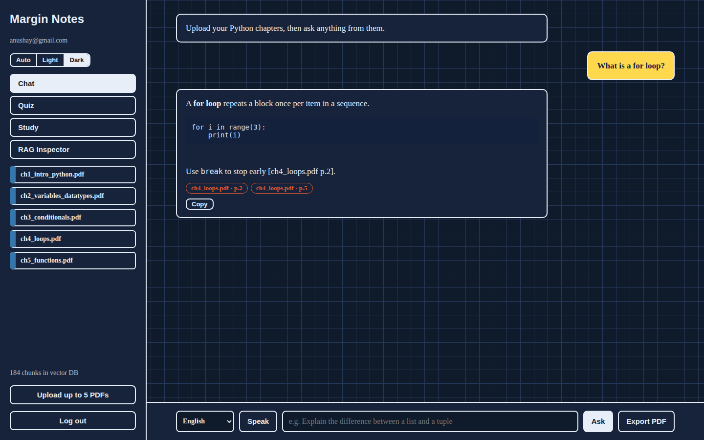 | 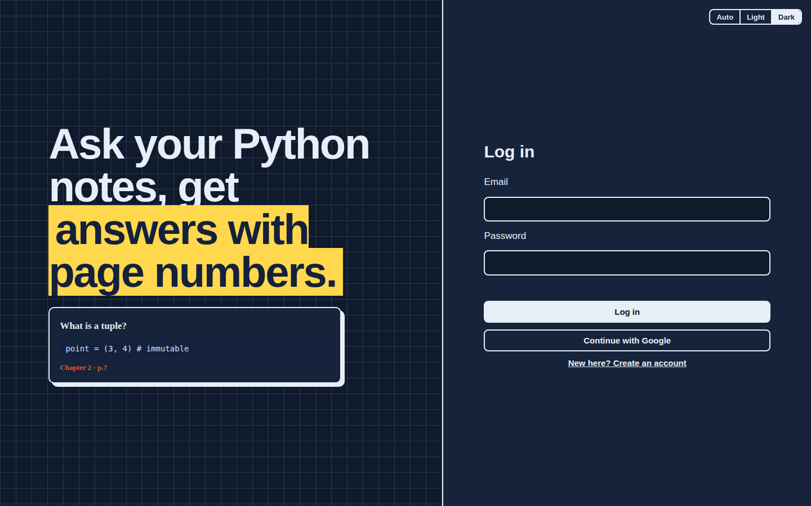 |

## How it works
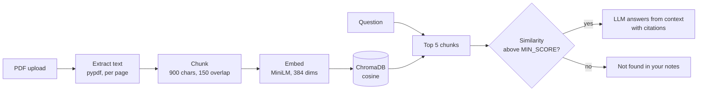

## Architecture
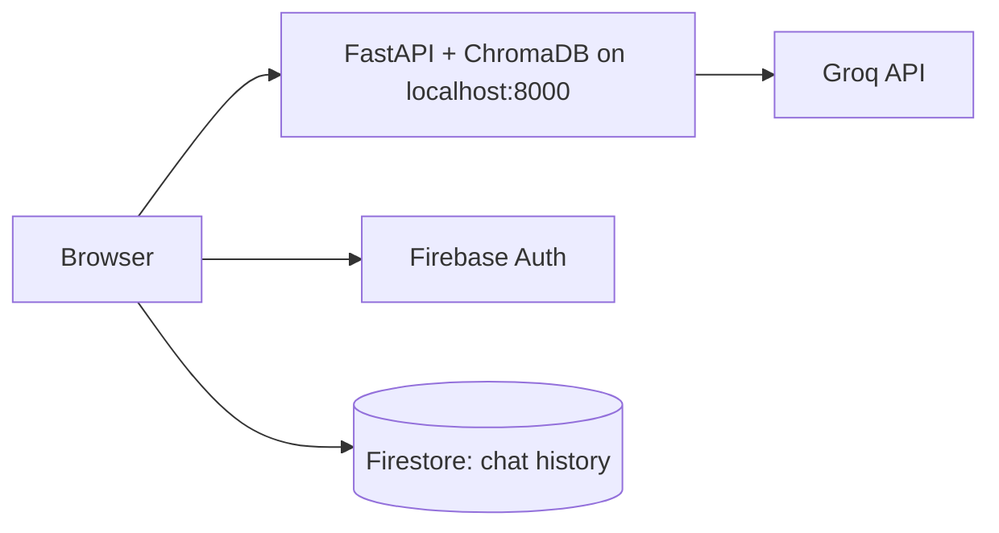
The FastAPI application serves both the web page and the API on your own computer, keeps the vector database on disk, and calls the Groq API for answers. Firebase Authentication (login) and Firestore (chat history) are used from the free Spark plan. The project is not deployed online.

## Tech stack
| Layer | Technology |
|---|---|
| Backend | FastAPI, Uvicorn, pypdf |
| Vector store and embeddings | ChromaDB, all-MiniLM-L6-v2 (local ONNX) |
| LLM | Groq `openai/gpt-oss-20b` through an OpenAI-compatible client; Grok (xAI) also supported |
| Frontend | HTML, CSS, JavaScript (no framework) |
| Auth and data | Firebase Authentication, Firestore |
| Run | Local Uvicorn server (a Dockerfile is included for hosting later) |

## Project structure
```
ai-study-assistant/
├── backend/
│   ├── main.py               FastAPI app: upload, ask, quiz, study, inspect, eval
│   ├── evaluate.py           command-line retrieval evaluation
│   ├── requirements.txt
│   ├── Dockerfile            builds the image and the vector DB
│   ├── .env.example
│   ├── data/
│   │   ├── pdfs/             5 sample Python chapters
│   │   └── eval_set.json     10 evaluation questions
│   └── tests/test_api.py     16 offline tests
├── frontend/
│   ├── index.html
│   ├── style.css
│   ├── app.js
│   └── firebase-config.js    paste your Firebase web config here
├── docs/                     report and slides (PDF, DOCX, PPTX), setup guide, LinkedIn post
├── images/screenshots/       UI screenshots
├── firebase.json             Firestore rules (and optional Hosting) config
├── firestore.rules           each user can read and write only their own chat
└── LICENSE
```

## Getting started
```bash
git clone https://github.com/scientistayat-engineer/ai-study-assistant.git
cd ai-study-assistant/backend
python -m venv .venv
.venv\Scripts\activate            # macOS/Linux: source .venv/bin/activate
pip install -r requirements.txt
copy .env.example .env            # macOS/Linux: cp .env.example .env, then add GROQ_API_KEY
python -c "import main; print(main.ingest_folder())"   # index the sample PDFs (first run downloads the embedding model)
uvicorn main:app --reload
```
Open http://localhost:8000. Login needs your Firebase web config in `frontend/firebase-config.js`; the full setup is in [docs/SETUP.md](docs/SETUP.md).

### Configuration
| Variable | Meaning |
|---|---|
| `LLM_PROVIDER` | `groq` (default) or `grok` (xAI) |
| `GROQ_API_KEY` / `XAI_API_KEY` | API key for the chosen provider |
| `LLM_MODEL` | Optional model override (default `openai/gpt-oss-20b` for Groq) |
| `MIN_SCORE` | Similarity threshold for the guard (default `0.2`) |
| `FIREBASE_PROJECT_ID` | Turns on login verification (leave empty locally) |
| `CORS_ORIGINS` | Comma-separated pages allowed to call the API (defaults to the Firebase Hosting URLs and localhost) |

## API
| Endpoint | Purpose |
|---|---|
| `POST /api/upload` | Upload up to 5 PDFs; extract, chunk, embed, save |
| `GET /api/docs` | Indexed PDFs and chunk count |
| `POST /api/ask` | Retrieve chunks and stream an LLM answer with sources |
| `POST /api/quiz` | Generate multiple-choice questions |
| `POST /api/study` | Chapter summary or flashcards |
| `GET /api/inspect` | Embedding stats and samples |
| `GET /api/eval` | Run the retrieval evaluation |

All endpoints expect `Authorization: Bearer <Firebase ID token>` when `FIREBASE_PROJECT_ID` is set.

## Testing and evaluation
On the 5 sample chapters the 10-question retrieval check scores **100% top-1, 100% top-5, MRR 1.0**.

```bash
cd backend
python tests/test_api.py     # 16 offline checks (fake embeddings + fake LLM), no API key needed
python evaluate.py           # top-1, top-5 and MRR on 10 questions
```

## Running locally
The project is run locally, as described in [Getting started](#getting-started). For chat history, deploy the free Firestore rules once with `firebase deploy --only firestore:rules`; every step is in [docs/SETUP.md](docs/SETUP.md), which also has an optional outline for hosting it online later.

## Limitations and roadmap
- The app is not hosted online: it is available only while `uvicorn` runs on your computer, and uploaded PDFs and the vector database stay on that computer
- [ ] Host it online (Firebase Hosting plus a container host)
- [ ] OCR for scanned PDFs
- [ ] Separate collection per user
- [ ] Re-ranking of retrieved chunks
- [ ] Larger evaluation set

## Documentation
- [Project report](docs/Margin_Notes_Report.pdf) ([DOCX](docs/Margin_Notes_Report.docx))
- [Presentation](docs/Margin_Notes_Presentation.pdf) ([PPTX](docs/Margin_Notes_Presentation.pptx))
- [Setup guide](docs/SETUP.md)

## Author
**Anushay Ayat** · AI and Data Science, SMIT · [GitHub @scientistayat-engineer](https://github.com/scientistayat-engineer)

Released under the [MIT License](LICENSE).
